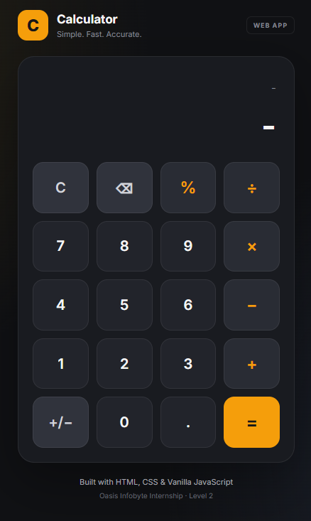
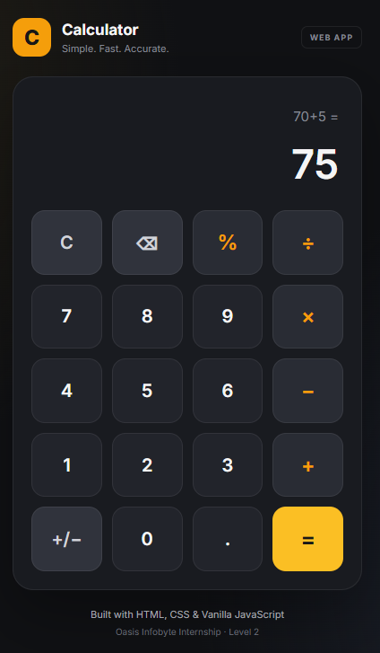
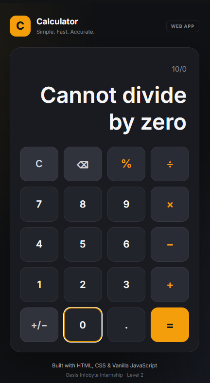

# Calculator — Interactive Web Calculator

**A Simple, Responsive & Interactive Arithmetic Calculator**

Built with HTML5, CSS3, and Vanilla JavaScript

---

## Overview

Calculator is a lightweight web-based arithmetic application developed as part of the **Oasis Infobyte Internship Program — Web Development & Designing, Level 2**.

The application provides an interactive calculator interface for performing basic arithmetic operations, featuring a responsive keypad, real-time expression display, keyboard support, and custom arithmetic evaluation logic.

Built entirely with HTML, CSS, and Vanilla JavaScript, this project demonstrates DOM manipulation, event-driven programming, input validation, and mathematical expression parsing without relying on JavaScript's `eval()` function.

## Features

### Core Functionality

- **Basic Arithmetic Operations** — Supports addition, subtraction, multiplication, and division.
- **Modulo Operation** — Calculates the remainder of a division operation.
- **Operator Chaining** — Allows multiple arithmetic operations within a single expression.
- **Decimal Input** — Supports decimal number calculations.
- **Sign Toggle** — Provides positive and negative sign switching.
- **Clear Function** — Resets the calculator display and current expression.
- **Backspace** — Removes the most recently entered character.
- **Calculation Result** — Displays the evaluated result with numerical formatting.

### Interactive Experience

- Real-time expression and result display.
- Keyboard support for numeric input and arithmetic operators.
- `Enter` or `=` to calculate.
- `Backspace` to remove the last character.
- `Escape` to clear the calculator.
- Responsive keypad layout using CSS Grid.
- Interactive button hover and active states.

### Error Handling

- Detects division by zero.
- Prevents modulo-by-zero calculations.
- Validates arithmetic expressions before evaluation.
- Handles invalid expressions and non-finite calculation results.

## Technology Stack

| Technology | Purpose |
|---|---|
| HTML5 | Application structure and semantic elements |
| CSS3 | Responsive layout, styling, and interactive states |
| Vanilla JavaScript | Calculator logic and DOM interactions |
| CSS Grid | Four-column calculator keypad |
| Google Fonts — Inter | Application typography |

**No external JavaScript frameworks or calculation libraries are required.**

## Application Preview

The following screenshots demonstrate the calculator interface, calculation functionality, error handling, and responsive mobile layout.

### 1. Main Calculator Interface



*Main calculator interface and interactive keypad.*

### 2. Calculation Result



*Example arithmetic expression and calculated result.*

### 3. Error Handling



*Division-by-zero and invalid calculation handling.*

### 4. Responsive Mobile Interface


*Responsive calculator interface on mobile screens.*

## Project Structure

```text
WebDev-L2-Calculator/
│
├── index.html
├── style.css
├── script.js
├── README.md
│
└── screenshots/
    ├── calculator-preview.png
    ├── calculation-result.png
    ├── error-handling.png
    └── mobile-view.png
```

## Installation & Setup

This application runs directly in a modern web browser and does not require a backend server or package installation.

### 1. Clone the Repository

```bash
git clone https://github.com/YOUR-USERNAME/OIBSIP.git
```

### 2. Navigate to the Project Directory

```bash
cd OIBSIP/WebDev-L2-Calculator
```

### 3. Run the Application

Open `index.html` directly in your browser.

Alternatively, use the Visual Studio Code Live Server extension to run the application through a local development server.

## Usage Guide

1. Open the Calculator application in your browser.
2. Enter numbers using the on-screen keypad or keyboard.
3. Select an arithmetic operator.
4. Continue entering numbers to build an expression.
5. Press `=` or `Enter` to evaluate the expression.
6. Use `C` to reset the calculator or `⌫` to remove the last character.

### Keyboard Shortcuts

| Key | Action |
|---|---|
| `0–9` | Enter numeric values |
| `+` `-` `*` `/` | Arithmetic operators |
| `%` | Modulo operation |
| `.` | Decimal point |
| `Enter` or `=` | Calculate result |
| `Backspace` | Delete last character |
| `Escape` | Clear calculator |

## Implementation Highlights

### 1. Custom Arithmetic Expression Parser

The calculator implements a custom recursive-descent parser to evaluate mathematical expressions without using JavaScript's `eval()` function.

The parsing process consists of:

- **Tokenization:** Converts the input expression into numeric and operator tokens.
- **Expression Parsing:** Handles addition and subtraction.
- **Term Parsing:** Handles multiplication, division, and modulo operations.
- **Unary Parsing:** Supports positive and negative numeric values.
- **Validation:** Checks expression completeness and ensures the result is finite.

This parsing structure applies standard arithmetic operator precedence, where multiplication, division, and modulo are evaluated before addition and subtraction.

### 2. Event Delegation

The application uses event delegation on the calculator keypad rather than inline event handlers.

This approach centralizes button interactions through a single event listener and uses HTML `data-*` attributes to identify each button's action.

### 3. Keyboard Interaction

A global keyboard event listener enables users to operate the calculator without relying exclusively on mouse interactions.

### 4. Responsive User Interface

CSS Grid provides a consistent four-column keypad layout, while responsive styling adjusts spacing, padding, and button dimensions for smaller screens.

## Learning Outcomes

This project strengthened practical understanding of:

- Semantic HTML and accessible interface structure.
- CSS layout techniques and responsive design.
- JavaScript DOM manipulation and event delegation.
- Mathematical expression tokenization and parsing.
- Recursive-descent parsing and operator precedence.
- Input validation and calculation error handling.
- Keyboard event handling and interactive user experiences.

## Internship Information

| Information | Details |
|---|---|
| Organization | Oasis Infobyte |
| Internship Track | Web Development & Designing |
| Level | Level 2 |
| Project | Calculator |
| Developer | Muh. Azzam Izzadin |

---

**Developed by Muh. Azzam Izzadin**

Web Development & Designing — Level 2

*Oasis Infobyte Internship Program*
