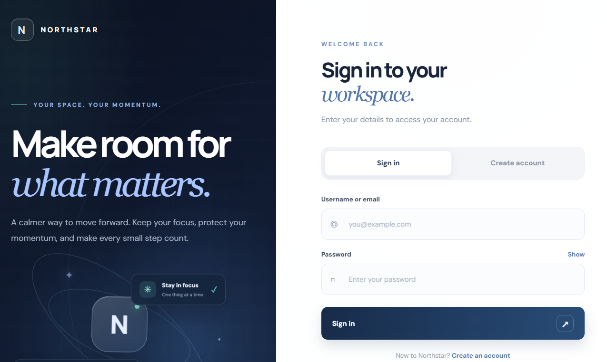

# Northstar — User Authentication System

<p align="center">
  <strong>Your Space. Your Momentum.</strong>
  <br />
  A Modern Web-Based Authentication Application
  <br />
  Built with HTML5, CSS3, JavaScript, Node.js, and Express.js
</p>

<p align="center">
  
</p>

---

## Overview

**Northstar** is a web-based user authentication application designed to provide a modern, intuitive, and secure account access experience.

Developed as part of the **Oasis Infobyte Internship Program — Web Development & Designing, Level 2**, this project demonstrates the implementation of a complete authentication workflow, including user registration, login, password hashing, session management, and protected dashboard access.

The application combines a modern split-screen authentication interface with a server-side authentication system powered by Node.js and Express.js.

Northstar focuses on maintaining a clear separation between the user interface, authentication logic, and protected application resources.

## Features

### 1. User Registration

- Account creation using username, email address, and password.
- Username validation with a minimum of 3 and maximum of 24 characters.
- Email format validation.
- Password requirements:
  - Minimum 8 characters.
  - At least one numeric character.
- Duplicate username and email prevention.
- Password hashing before storage using bcryptjs.
- Interactive password strength indicator.
- Real-time password requirement feedback.

### 2. User Login

- Authentication using username or email address.
- Password verification against stored password hashes.
- Generic invalid credential error messages.
- Login form validation.
- Password visibility toggle.
- Session regeneration after successful authentication.

### 3. Session Management

- Server-side session-based authentication.
- HTTP-only session cookies.
- SameSite cookie configuration.
- Session expiration configured for two hours.
- Automatic session handling for authenticated users.
- Logout functionality to terminate the active session.

### 4. Protected Dashboard

- Restricted dashboard access for authenticated users.
- User-specific welcome message.
- Account status information.
- Registered username display.
- Registered email address display.
- Active session information.
- Sign-out functionality.

### 5. Authentication Interface

- Modern split-screen layout.
- Interactive sign-in and registration tabs.
- Animated interface transitions.
- Password visibility controls.
- Input validation indicators.
- Password strength visualization.
- Responsive layout for different screen sizes.
- Consistent Northstar visual identity across authentication and dashboard pages.

## Technology Stack

| Technology | Purpose |
|---|---|
| HTML5 | Authentication and dashboard structure |
| CSS3 | Responsive interface and visual styling |
| Vanilla JavaScript | Client-side interactions and API communication |
| Node.js | Server-side JavaScript runtime |
| Express.js | Backend application and HTTP routing |
| Express Session | Session-based authentication |
| bcryptjs | Password hashing and verification |
| JSON Storage | User account data persistence |
| Google Fonts | DM Sans and Manrope typography |

## Application Architecture

Northstar follows a client-server architecture that separates frontend interactions from backend authentication processing.

### Authentication Workflow

```text
             USER
               |
               v
       Authentication UI
               |
         Register / Login
               |
               v
        Express.js Server
               |
         Input Validation
               |
               v
       Authentication Logic
               |
          bcryptjs
               |
               v
         JSON User Storage
               |
               v
       Session Management
               |
        Authentication
           Successful
               |
               v
       Protected Dashboard
```

### Authentication Flow

**Registration Process**

1. User submits username, email, and password.
2. Server validates the submitted information.
3. Server checks for existing username or email.
4. Password is hashed using bcryptjs.
5. User account information is stored in JSON storage.
6. Server returns an appropriate registration response.

**Login Process**

1. User submits username or email and password.
2. Server retrieves the corresponding account.
3. bcryptjs verifies the submitted password against the stored hash.
4. Server regenerates the session after successful authentication.
5. Authenticated user information becomes available to the protected dashboard.

**Protected Route Process**

1. User requests the dashboard.
2. Express.js checks the authentication session.
3. Unauthenticated requests are redirected to the login page.
4. Authenticated users can access their dashboard.

## API Endpoints

The backend provides the following authentication endpoints:

| Method | Endpoint | Description |
|---|---|---|
| POST | `/api/register` | Register a new user |
| POST | `/api/login` | Authenticate an existing user |
| GET | `/api/me` | Retrieve the current authenticated user |
| POST | `/api/logout` | Terminate the current session |
| GET | `/dashboard` | Access the protected dashboard |

## Security Implementation

Security is an important part of Northstar's authentication workflow.

The application implements several security-related mechanisms:

- **Password Hashing:** Passwords are hashed using bcryptjs before being stored.
- **Credential Verification:** Passwords are verified against stored hashes rather than compared as plaintext.
- **Duplicate Account Prevention:** Existing usernames and email addresses cannot be registered again.
- **Session-Based Authentication:** Protected resources require a valid authenticated session.
- **HTTP-Only Cookies:** Session cookies are configured to prevent direct JavaScript access.
- **SameSite Cookie Policy:** Helps reduce cross-site request risks.
- **Session Regeneration:** A new session is generated after successful login.
- **Generic Login Errors:** Prevents login responses from unnecessarily revealing whether an account exists.

## Application Preview

Add actual screenshots of the running Northstar application to the `screenshots/` directory.

| Screenshot | Description |
|---|---|
| `northstar-preview.png` | Main sign-in interface |
| `register-interface.png` | User registration interface |
| `password-strength.png` | Password strength and validation indicators |
| `dashboard-preview.png` | Authenticated user dashboard |
| `mobile-view.png` | Responsive authentication interface |

## Project Structure

```text
WebDev-L2-LoginAuthentication/
│
├── public/
│   ├── index.html
│   ├── css/
│   │   └── style.css
│   └── js/
│       ├── auth.js
│       └── dashboard.js
│
├── views/
│   └── dashboard.html
│
├── data/
│   └── .gitkeep
│
├── screenshots/
│   ├── northstar-preview.png
│   ├── register-interface.png
│   ├── password-strength.png
│   ├── dashboard-preview.png
│   └── mobile-view.png
│
├── .gitignore
├── package.json
├── server.js
└── README.md
```

## Installation & Setup

### Prerequisites

Make sure the following tools are installed:

- Node.js 18 or later.
- npm (Node Package Manager).
- Git.

### 1. Clone the Repository

```bash
git clone https://github.com/YOUR-USERNAME/OIBSIP.git
```

### 2. Navigate to the Project Directory

```bash
cd OIBSIP/WebDev-L2-LoginAuthentication
```

### 3. Install Dependencies

```bash
npm install
```

### 4. Start the Application

```bash
npm start
```

### 5. Open the Application

Navigate to the following address in your browser:

```text
http://localhost:3000
```

You can now register a new account, sign in, access the protected dashboard, and test the logout functionality.

## Usage Guide

1. Open the Northstar application.
2. Select **Create account** to register a new user.
3. Enter a username, valid email address, and password that meets the required criteria.
4. Submit the registration form.
5. Return to the sign-in interface.
6. Authenticate using your username or email and password.
7. Access the protected dashboard after successful authentication.
8. Review your account information.
9. Select **Sign out** to terminate your session.

## Interface Design

Northstar adopts a modern, minimalist visual direction that emphasizes focus, clarity, and a consistent user experience.

**Design characteristics:**

- **Color Palette:** Deep navy backgrounds with blue and cyan-inspired visual accents.
- **Typography:** DM Sans and Manrope for clear and contemporary typography.
- **Layout:** Split-screen authentication interface with a dedicated visual panel and form panel.
- **Visual Elements:** Decorative orbital graphics, glowing elements, and floating information cards.
- **Interaction:** Animated tab transitions, input feedback, and password strength indicators.
- **Dashboard:** Consistent branding with account information cards and session status indicators.
- **Responsive Design:** Adaptive layout for desktop and smaller screen sizes.

## Learning Outcomes

Through this project, I strengthened my practical understanding of:

- Developing full-stack web applications using Node.js and Express.js.
- Designing and implementing authentication workflows.
- Building REST-style authentication endpoints.
- Implementing password hashing and verification using bcryptjs.
- Managing authenticated user sessions.
- Protecting application routes through server-side authentication checks.
- Handling user registration and login validation.
- Integrating frontend forms with backend API endpoints.
- Structuring backend applications and managing JSON-based data storage.
- Designing responsive authentication and dashboard interfaces.

## Internship Information

| Information | Details |
|---|---|
| Organization | Oasis Infobyte |
| Internship Track | Web Development & Designing |
| Level | Level 2 |
| Task | Login Authentication |
| Application Name | Northstar |
| Backend | Node.js & Express.js |
| Developer | Muh. Azzam Izzadin |

---

<p align="center">
  <strong>Designed & Developed by Muh. Azzam Izzadin</strong>
  <br />
  Web Development & Designing — Level 2
  <br />
  <sub>Oasis Infobyte Internship Program</sub>
</p>
