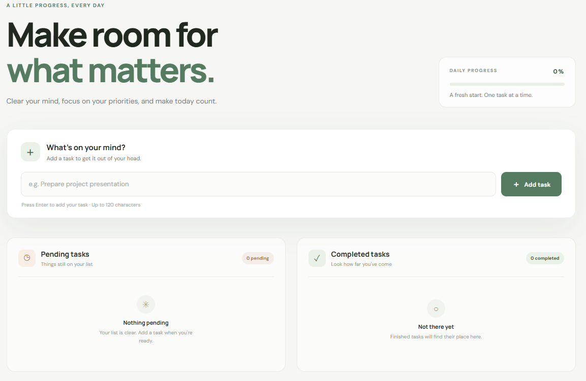
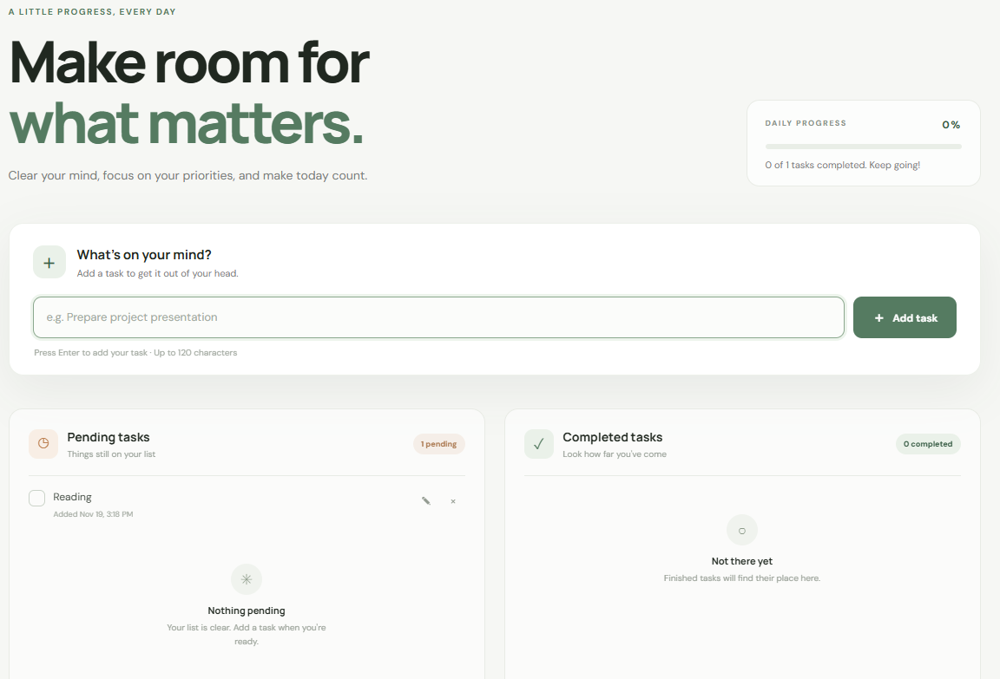
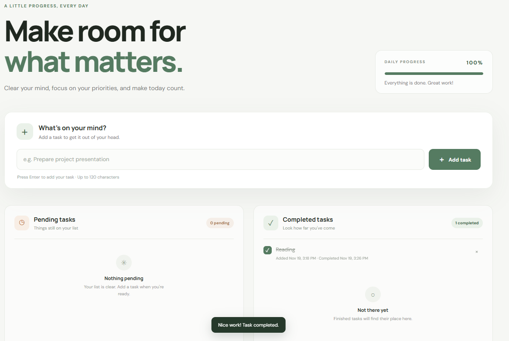
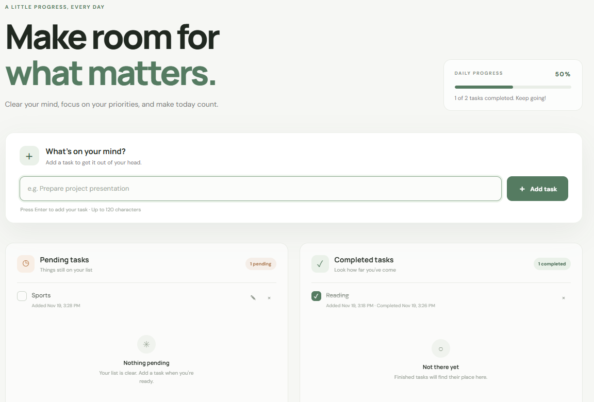

# Daylist — Personal Task Management Application

**Make Room for What Matters.**

A Simple, Elegant & Interactive To-Do Web Application

Built with HTML5, CSS3, and Vanilla JavaScript

---

## Overview

**Daylist** is a web-based personal task management application designed to help users organize daily activities, manage priorities, and monitor their productivity through a clean and intuitive interface.

Developed as part of the **Oasis Infobyte Internship Program — Web Development & Designing, Level 2**, this project focuses on implementing interactive task management functionality with a user-friendly experience.

The application provides a centralized workspace where users can create, update, complete, and remove tasks while monitoring their daily progress through task statistics and a visual progress indicator.

## Features

### 1. Task Management

- **Add Tasks** — Create new tasks using an interactive input form.
- **Edit Tasks** — Modify existing task descriptions.
- **Delete Tasks** — Remove tasks that are no longer needed.
- **Complete Tasks** — Mark tasks as completed.
- **Task Validation** — Prevent empty task submissions.
- **Character Limit** — Supports task descriptions up to 120 characters.

### 2. Task Organization

- **Pending Tasks** — Displays tasks that have not been completed.
- **Completed Tasks** — Separates finished tasks from pending activities.
- **Task Counters** — Shows the total number of pending and completed tasks.
- **Empty States** — Displays contextual messages when task lists are empty.

### 3. Daily Progress Tracking

- Visual daily progress indicator.
- Dynamic completion percentage.
- Progress bar that reflects task completion.
- Contextual progress messages.
- Task statistics updated based on application activity.

### 4. User Experience

- Minimalist and responsive interface.
- Interactive task management workflow.
- Dynamic date label.
- Keyboard interaction through the Enter key.
- Toast notification area for application feedback.
- Clear visual distinction between pending and completed tasks.

### 5. Data Persistence

The application uses browser-based storage to retain task information between sessions.

Tasks can remain available after refreshing the browser, without requiring a backend server or external database.

## Technology Stack

| Technology | Purpose |
|---|---|
| HTML5 | Semantic application structure and forms |
| CSS3 | Interface styling, layout, and responsive design |
| Vanilla JavaScript | Task management logic and DOM manipulation |
| Local Storage | Client-side task data persistence |
| Google Fonts | DM Sans and Manrope typography |

**No external JavaScript frameworks or backend services are required.**

## Application Preview

The following screenshots demonstrate the main interfaces and functionality of Daylist.

### 1. Main Application Dashboard



*Main application dashboard.*

### 2. Pending Tasks



*Pending task management interface.*

### 3. Completed Tasks



*Completed task list.*

### 4. Daily Progress Tracking



*Daily progress tracking.*

### 5. Responsive Mobile Interface


*Responsive mobile interface.*

## Project Structure

```text
WebDev-L2-ToDoApp/
│
├── index.html
│
├── css/
│   └── style.css
│
├── js/
│   └── app.js
│
├── screenshots/
│   ├── daylist-preview.png
│   ├── pending-tasks.png
│   ├── completed-tasks.png
│   ├── progress-tracking.png
│   └── mobile-view.png
│
└── README.md
```

## Installation & Setup

Daylist is a client-side web application that can run directly in a modern web browser.

### 1. Clone the Repository

```bash
git clone https://github.com/YOUR-USERNAME/OIBSIP.git
```

### 2. Navigate to the Project Directory

```bash
cd OIBSIP/WebDev-L2-ToDoApp
```

### 3. Run the Application

Open `index.html` directly in your browser.

Alternatively, use the Visual Studio Code Live Server extension to run the application through a local development server.

## Usage Guide

1. Open the Daylist application in your browser.
2. Enter a task description in the input field.
3. Click **Add Task** or press `Enter`.
4. Manage tasks through the available edit, delete, and completion actions.
5. Monitor pending and completed task counts.
6. Track daily productivity through the progress indicator.

## Interface Design

Daylist adopts a minimalist productivity-oriented visual direction, emphasizing clarity, readability, and ease of interaction.

**Design characteristics:**

- **Color Palette:** Soft neutral backgrounds complemented by green accents.
- **Typography:** DM Sans and Manrope for a modern and readable appearance.
- **Layout:** Structured dashboard with separate pending and completed task sections.
- **Progress Visualization:** Dedicated progress card with a dynamic progress bar.
- **Empty States:** Contextual illustrations and messages to improve the user experience.
- **Responsive Layout:** Flexible content presentation across different screen sizes.

## Implementation Highlights

### 1. Dynamic Task Rendering

The application organizes task information into separate pending and completed lists, allowing the interface to reflect changes in task status.

### 2. Task State Management

Task operations update the application's data and interface, supporting task creation, modification, completion, and deletion.

### 3. Progress Calculation

The progress indicator represents the proportion of completed tasks relative to the total number of tasks.

The general calculation is:

```javascript
progress = totalTasks > 0
    ? (completedTasks / totalTasks) * 100
    : 0;
```

### 4. Browser-Based Data Persistence

Local Storage provides a mechanism for retaining task data in the browser, allowing the application to restore saved tasks when users revisit or refresh the page.

### 5. Interactive User Interface

DOM manipulation and JavaScript event handling provide dynamic updates to task lists, counters, progress indicators, and user feedback.

## Learning Outcomes

Through this project, I strengthened my practical understanding of:

- Building interactive task management applications.
- JavaScript DOM manipulation and event handling.
- Managing task states and application data.
- Implementing CRUD operations in a client-side application.
- Persisting application data using Local Storage.
- Calculating and visualizing task completion progress.
- Designing responsive and user-friendly web interfaces.
- Organizing frontend application components and workflows.

## Internship Information

| Information | Details |
|---|---|
| Organization | Oasis Infobyte |
| Internship Track | Web Development & Designing |
| Level | Level 2 |
| Task | To-Do Web App |
| Application Name | Daylist |
| Developer | Muh. Azzam Izzadin |

---

**Designed & Developed by Muh. Azzam Izzadin**

Web Development & Designing — Level 2

*Oasis Infobyte Internship Program*
